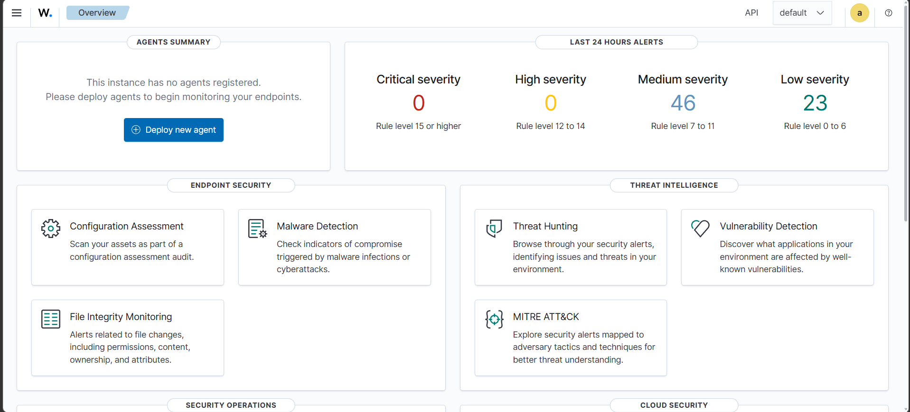

# Wazuh SOC / SIEM Home Lab

แล็บ SOC (Security Operations Center) ขนาดเล็กบนเครื่องคอมพิวเตอร์ RAM 8 GB โดยใช้ **Wazuh** เป็น SIEM/XDR
เพื่อฝึกเก็บ log, ตรวจจับการโจมตี, อ่าน alert และเขียน custom rule



## Lab topology

```
┌──────────────────────── Windows 11 host (RAM 8 GB) ────────────────────────┐
│                                                                            │
│   Windows (เครื่องจริง)                 VMware Workstation – NAT (VMnet8)    │
│   - Wazuh agent          ── logs ──▶   ┌───────────────────────────────┐   │
│   - Sysmon                             │ Ubuntu Server 26.04.1 LTS     │   │
│   - Browser → dashboard ◀─ https ──    │ 192.168.38.130                │   │
│                                        │ - Wazuh manager/indexer/dash  │   │
│            ◀── simulated attacks ──    │ - nmap, hydra (attacker tools)│   │
│                                        └───────────────────────────────┘   │
└────────────────────────────────────────────────────────────────────────────┘
```

| เครื่อง | OS | หน้าที่ |
|---|---|---|
| Wazuh server (VM) | Ubuntu Server 26.04.1 LTS, 2 vCPU, 4 GB RAM, 80 GB disk | SIEM: manager + indexer + dashboard และใช้เป็นเครื่องโจมตีจำลอง |
| Endpoint (host) | Windows 11 | เครื่องที่ถูกเฝ้าระวัง: Wazuh agent + Sysmon |

## เครื่องมือที่ใช้

- **Wazuh 4.14** (all-in-one) – SIEM / XDR
- **VMware Workstation Pro** – hypervisor
- **Ubuntu Server 26.04.1 LTS** – OS ของ Wazuh server
- **Sysmon** – เก็บ log ระดับ process / network บน Windows
- **nmap, hydra** – จำลองการโจมตี

## ความคืบหน้า

- [x] [01 – สร้าง VM และติดตั้ง Ubuntu Server](docs/01-vm-setup.md)
- [x] [02 – ติดตั้ง Wazuh all-in-one](docs/02-wazuh-install.md)
- [x] [03 – ติดตั้ง Wazuh agent บน Windows](docs/03-windows-agent-sysmon.md) (Sysmon: TODO)
- [ ] [04 – จำลองการโจมตีและตรวจสอบ alert](docs/04-attack-simulation.md) (ทดสอบ logon failure แล้ว ✅)
- [ ] 05 – เขียน custom rules
- [ ] 06 – สรุปผลและบทเรียน

## ข้อจำกัดของแล็บ

- RAM ของเครื่องจริงมีแค่ 8 GB จึงรัน Wazuh บน VM เดียว (4 GB) และใช้ Windows host เป็น endpoint แทนการสร้าง Windows VM / Kali VM แยก
- ติดตั้ง Wazuh ด้วย flag `-i` เพื่อข้ามการตรวจสอบฮาร์ดแวร์/OS เพราะ RAM ต่ำกว่าที่แนะนำ และ Ubuntu 26.04 ยังไม่อยู่ในรายชื่อ OS ที่ Wazuh 4.x แนะนำ
- แล็บนี้มีไว้เพื่อการเรียนรู้เท่านั้น ไม่ใช่ระบบ production
