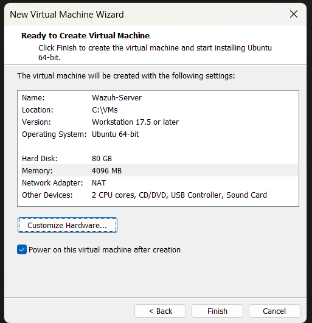
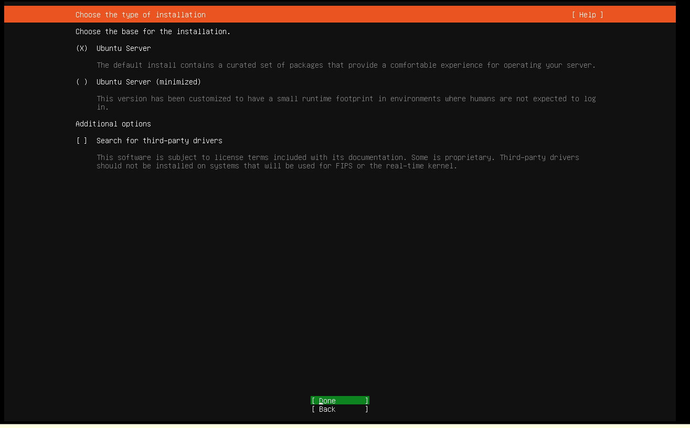
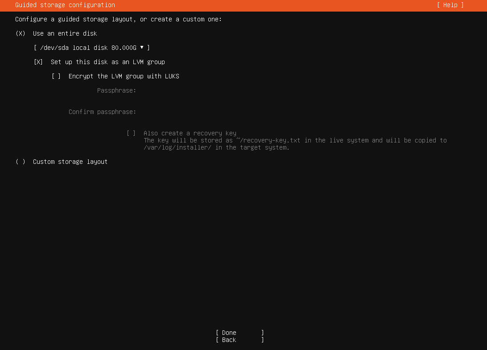
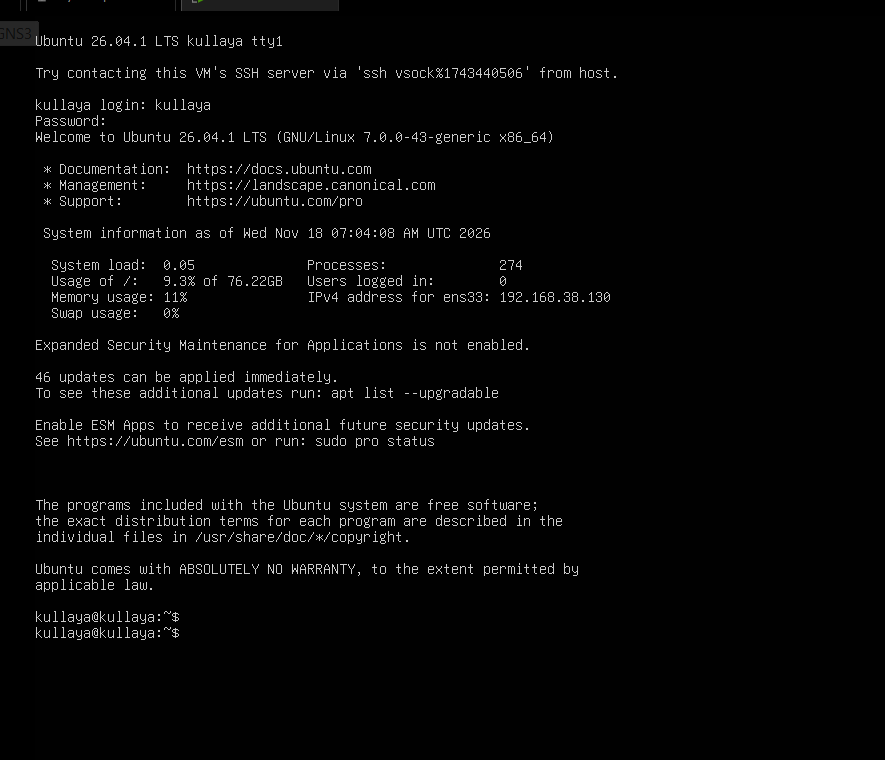

# 01 – สร้าง VM และติดตั้ง Ubuntu Server

## สเปก VM (VMware Workstation)

| รายการ | ค่า | เหตุผล |
|---|---|---|
| Name | `Wazuh-Server` | |
| Location | `C:\VMs` | ไม่เก็บไว้ใน OneDrive เพื่อไม่ให้ซิงก์ไฟล์ดิสก์ VM ขึ้นคลาวด์ |
| Disk | 80 GB, store as a single file | indexer ต้องใช้พื้นที่เก็บ log; ไฟล์เดียวเร็วกว่า |
| Memory | 4096 MB | ขั้นต่ำที่พอรัน Wazuh ได้ (host มี RAM 8 GB) |
| CPU | 2 cores | |
| Network | NAT | ใช้อินเทอร์เน็ตตอนติดตั้ง และเข้าถึงจาก host ได้ |

## ติดตั้ง Ubuntu Server 26.04.1 LTS

1. Installation type: **Ubuntu Server** (ไม่ใช่ minimized) และไม่เลือก third-party drivers

   

2. Proxy: เว้นว่าง
3. Storage: Use an entire disk + LVM, ไม่เข้ารหัส LUKS

   

4. หน้า Storage configuration: แก้ `ubuntu-lv` ให้ใช้พื้นที่เต็ม (ค่าเริ่มต้นใช้แค่ราวครึ่งดิสก์)
   - ถ้าลืม แก้ทีหลังได้ด้วย `sudo lvextend -r -l +100%FREE /dev/ubuntu-vg/ubuntu-lv`
5. ติ๊ก **Install OpenSSH server**
6. Ubuntu Pro / Featured snaps: ข้าม

## ผลลัพธ์

ล็อกอินได้ ดิสก์ `/` ได้ 76 GB และ VM ได้ IP `192.168.38.130`

