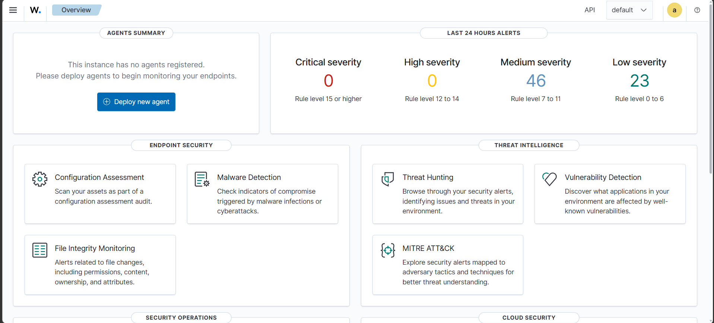

# 02 – ติดตั้ง Wazuh all-in-one

ติดตั้ง manager, indexer และ dashboard บนเครื่องเดียวด้วย installation assistant

## ขั้นตอน

SSH เข้า VM จาก PowerShell บน Windows:

```bash
ssh <user>@192.168.38.130
```

อัปเดตระบบ:

```bash
sudo apt update && sudo apt upgrade -y
```

ติดตั้ง Wazuh 4.14 (`-a` = all-in-one, `-i` = ข้ามการตรวจสอบฮาร์ดแวร์/OS):

```bash
curl -sO https://packages.wazuh.com/4.14/wazuh-install.sh && sudo bash ./wazuh-install.sh -a -i
```

ดูรหัสผ่านของ user `admin` ย้อนหลัง:

```bash
sudo tar -O -xvf wazuh-install-files.tar wazuh-install-files/wazuh-passwords.txt
```

> ⚠️ ห้าม commit `wazuh-install-files.tar` หรือรหัสผ่านใดๆ ขึ้น GitHub (กันไว้ใน `.gitignore` แล้ว)

## เข้า dashboard

เปิด `https://192.168.38.130` บนเบราว์เซอร์ของ Windows แล้วยอมรับคำเตือน certificate (self-signed) จากนั้นล็อกอินด้วย `admin`



ตอนนี้ยังไม่มี agent แต่มี alert แล้ว เพราะ Wazuh manager เฝ้าระวังเครื่องตัวเอง (agent `000`)
