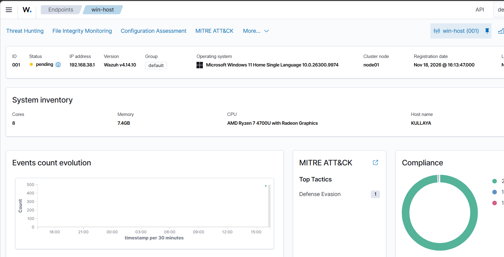
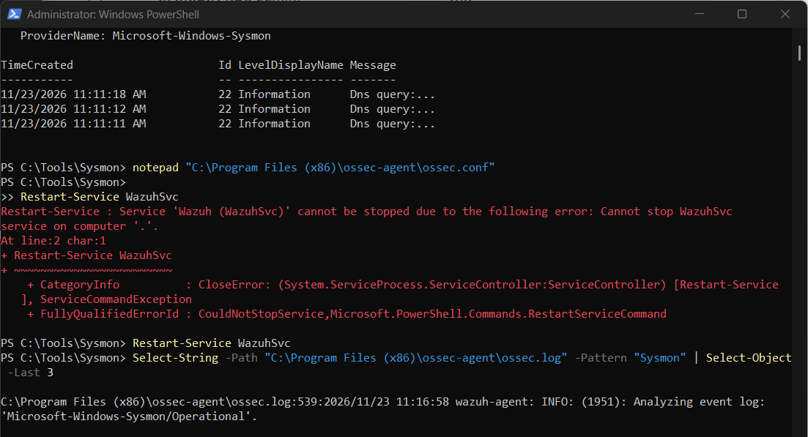

# 03 – ติดตั้ง Wazuh agent + Sysmon บน Windows

## 1. ติดตั้ง Wazuh agent ✅

1. ใน dashboard กด **Deploy new agent**
2. เลือก **Windows → MSI**, Server address: `192.168.38.130`, Agent name: `win-host`
3. เปิด **PowerShell แบบ Administrator** (คลิกขวาปุ่ม Start → Terminal (Admin)) แล้วติดตั้ง:

   ```powershell
   Invoke-WebRequest -Uri https://packages.wazuh.com/4.x/windows/wazuh-agent-4.14.10-1.msi -OutFile $env:tmp\wazuh-agent.msi
   Start-Process msiexec.exe -Wait -ArgumentList "/i $env:tmp\wazuh-agent.msi WAZUH_MANAGER=192.168.38.130 WAZUH_AGENT_NAME=win-host"
   NET START Wazuh
   ```

4. agent ลงทะเบียนสำเร็จเป็น ID `001` (สถานะ pending ช่วงแรก แล้วเปลี่ยนเป็น Active)



### ปัญหาที่เจอและวิธีแก้

| อาการ | สาเหตุ | วิธีแก้ |
|---|---|---|
| `NET START Wazuh` → *The service name is invalid* | `msiexec /q` รันเบื้องหลังและติดตั้งล้มเหลวแบบเงียบ เพราะ PowerShell ไม่ได้รันแบบ Administrator | ติดตั้งใหม่ด้วย `Start-Process ... -Wait` (ไม่ใช้ `/q`) เพื่อให้เห็นหน้าต่างติดตั้งและ error |
| `NET START Wazuh` → *System error 5 – Access is denied* | PowerShell ไม่ได้รันแบบ Administrator (path `C:\WINDOWS\system32` ไม่ได้แปลว่าเป็น admin) | เปิด Terminal (Admin) แล้วสั่ง `NET START Wazuh` ใหม่ |
| `Restart-Service WazuhSvc` → *Cannot stop service* | service กำลังทำงานค้างอยู่ในจังหวะนั้น | สั่งซ้ำอีกครั้ง |

บทเรียน: ตรวจแถบชื่อหน้าต่างว่ามีคำว่า **Administrator** ก่อนติดตั้งหรือจัดการ service เสมอ

## 2. ติดตั้ง Sysmon ✅

Sysmon (Microsoft Sysinternals) บันทึกกิจกรรมละเอียดของ Windows เช่น process ที่ถูกเปิดพร้อม command line และ parent process, การเชื่อมต่อเครือข่าย, ไฟล์ที่ถูกสร้าง และ DNS query ซึ่ง log ปกติของ Windows ไม่มี

ใช้ config ของ SwiftOnSecurity เพื่อกรอง noise (PowerShell แบบ Administrator):

```powershell
mkdir C:\Tools\Sysmon -Force; cd C:\Tools\Sysmon
Invoke-WebRequest https://download.sysinternals.com/files/Sysmon.zip -OutFile Sysmon.zip
Expand-Archive Sysmon.zip -DestinationPath . -Force
Invoke-WebRequest https://raw.githubusercontent.com/SwiftOnSecurity/sysmon-config/master/sysmonconfig-export.xml -OutFile sysmonconfig-export.xml
.\Sysmon64.exe -accepteula -i sysmonconfig-export.xml
```

ตรวจสอบ:

```powershell
Get-Service Sysmon64
Get-WinEvent -LogName Microsoft-Windows-Sysmon/Operational -MaxEvents 3
```

## 3. ให้ agent ส่ง log ของ Sysmon ✅

```powershell
notepad "C:\Program Files (x86)\ossec-agent\ossec.conf"
```

วางเนื้อหาจาก [`configs/windows-agent-sysmon.xml`](../configs/windows-agent-sysmon.xml) ไว้ก่อน `</ossec_config>` ตัวสุดท้าย แล้ว:

```powershell
Restart-Service WazuhSvc
Select-String -Path "C:\Program Files (x86)\ossec-agent\ossec.log" -Pattern "Sysmon" | Select-Object -Last 3
```

ผลลัพธ์: agent อ่าน event log ของ Sysmon แล้ว (`Analyzing event log: 'Microsoft-Windows-Sysmon/Operational'`)


