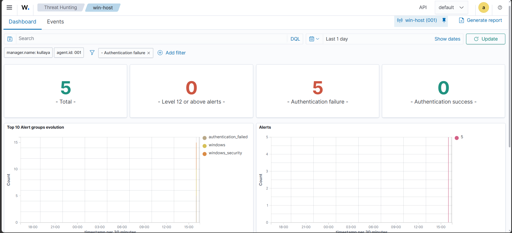

# 04 – จำลองการโจมตีและตรวจสอบ alert

> ทำเฉพาะกับเครื่องของตัวเองและเลือกเฉพาะการทดสอบที่ไม่ทำลายระบบ เพราะ endpoint ในแล็บนี้คือ Windows เครื่องจริง

| # | การทดสอบ | วิธี | สิ่งที่คาดว่าจะเจอ | ผล |
|---|---|---|---|---|
| 1 | ล็อกอินผิดหลายครั้ง | `runas /user:fakeuser cmd` แล้วใส่รหัสผิด 5 ครั้ง | Event 4625 Logon failure / MITRE T1110 | ✅ ตรวจพบ 5 alert |
| 2 | ล็อกอินผิดถี่ๆ (brute force) | ทำแบบข้อ 1 อย่างน้อย 10 ครั้งใน 1–2 นาที | alert ระดับสูงขึ้นเรื่องล็อกอินผิดหลายครั้ง | TODO |
| 3 | สร้าง local user ใหม่ | `net user testuser P@ssw0rd123 /add` (Admin) | Event 4720 User account created / T1136 | TODO |
| 4 | เพิ่ม user เข้า Administrators | `net localgroup administrators testuser /add` | Event 4732 / T1098 | TODO |
| 5 | คำสั่งสำรวจระบบ | `whoami /priv`, `net user`, `systeminfo` | Sysmon process creation / T1033, T1082 (ต้องลง Sysmon ก่อน) | TODO |
| 6 | SSH brute force ใส่ Wazuh server | จาก PowerShell: `ssh hacker@192.168.38.130` ใส่รหัสผิดหลายครั้ง | sshd authentication failed / T1110 | TODO |

หลังทดสอบข้อ 3–4 ให้ลบ user ทดสอบ:

```powershell
net user testuser /delete
```

---

## ผลการทดสอบ #1: Logon failure



**สิ่งที่เห็นใน Threat Hunting** (filter `agent.id: 001` + Authentication failure, ช่วง Last 1 day)

- Total 5 alert ทั้งหมดเป็น Authentication failure ตรงกับจำนวนครั้งที่ใส่รหัสผิด
- Level 12 ขึ้นไป = 0: การใส่รหัสผิด 5 ครั้งยังไม่ถึงเกณฑ์ของ rule ที่ตรวจจับ brute force
- Alert groups: `authentication_failed`, `windows`, `windows_security`

**ช่องที่ใช้ triage**

| ช่อง | ความหมาย |
|---|---|
| `rule.description` / `rule.level` | alert คืออะไร และร้ายแรงแค่ไหน |
| `data.win.system.eventID` | 4625 = logon failure |
| `data.win.eventdata.targetUserName` | user ที่ถูกลองล็อกอิน (`fakeuser`) |
| `data.win.eventdata.logonType` | 2 = ที่ตัวเครื่อง, 3 = ผ่านเครือข่าย, 10 = RDP |
| `rule.mitre.technique` | เทคนิคตาม MITRE ATT&CK |

**สรุปการ triage:** ใคร = user ไม่มีอยู่จริง (`fakeuser`) · ทำอะไร = ล็อกอินล้มเหลว 5 ครั้ง · ที่ไหน = `win-host` · ผล = **True positive (การทดสอบ)** ไม่ใช่การโจมตีจริง
