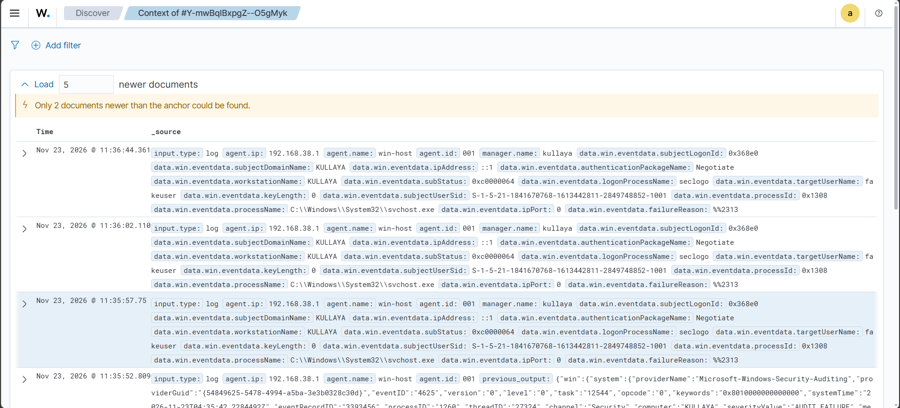
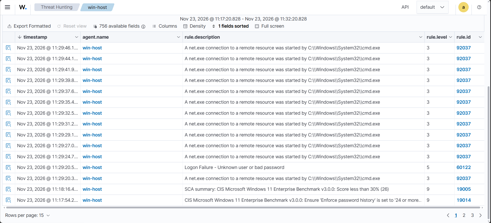
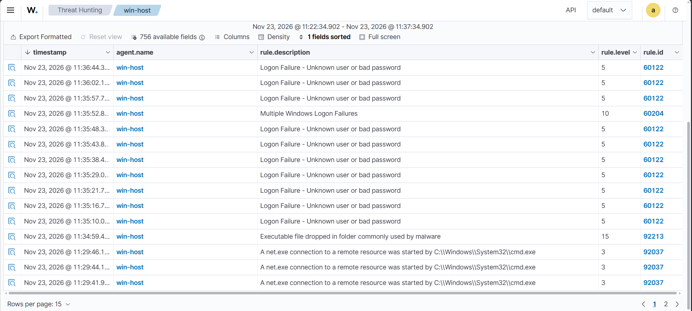
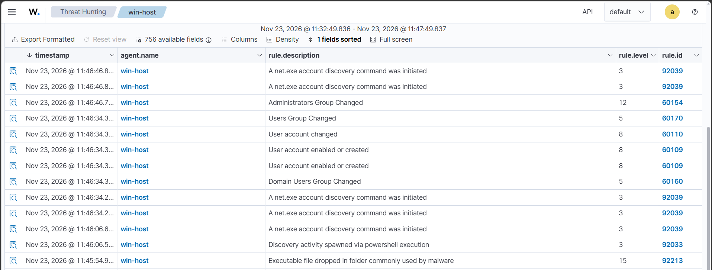
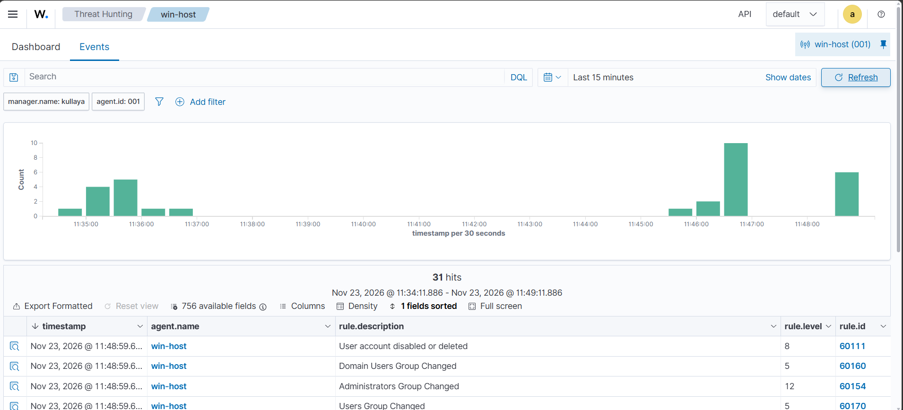
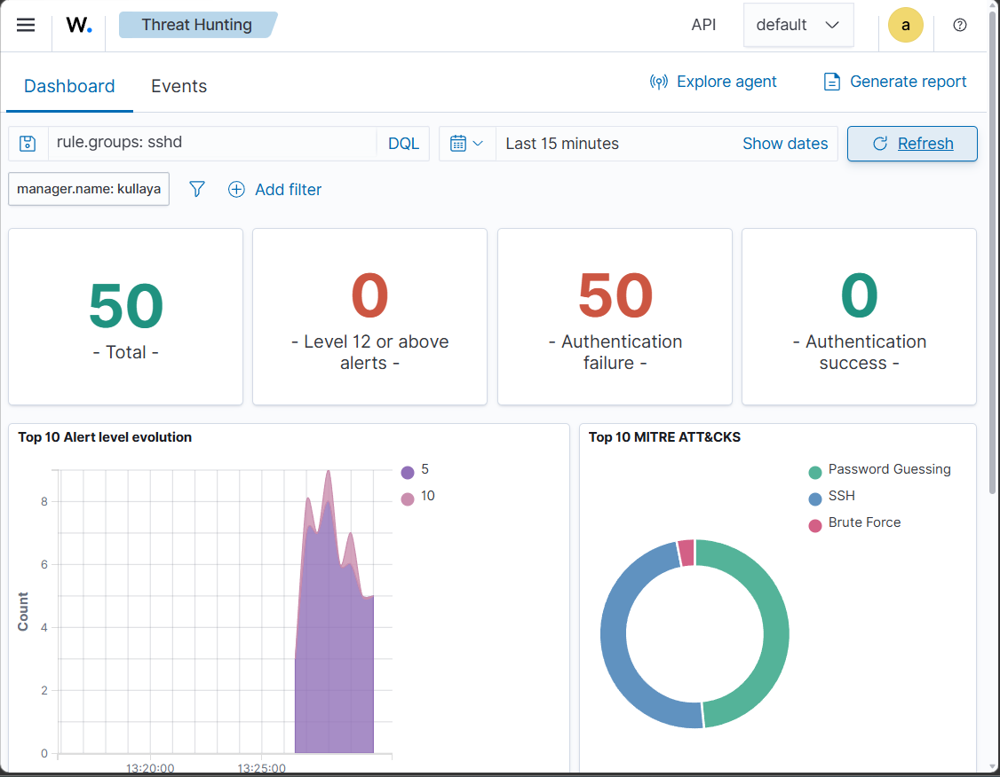
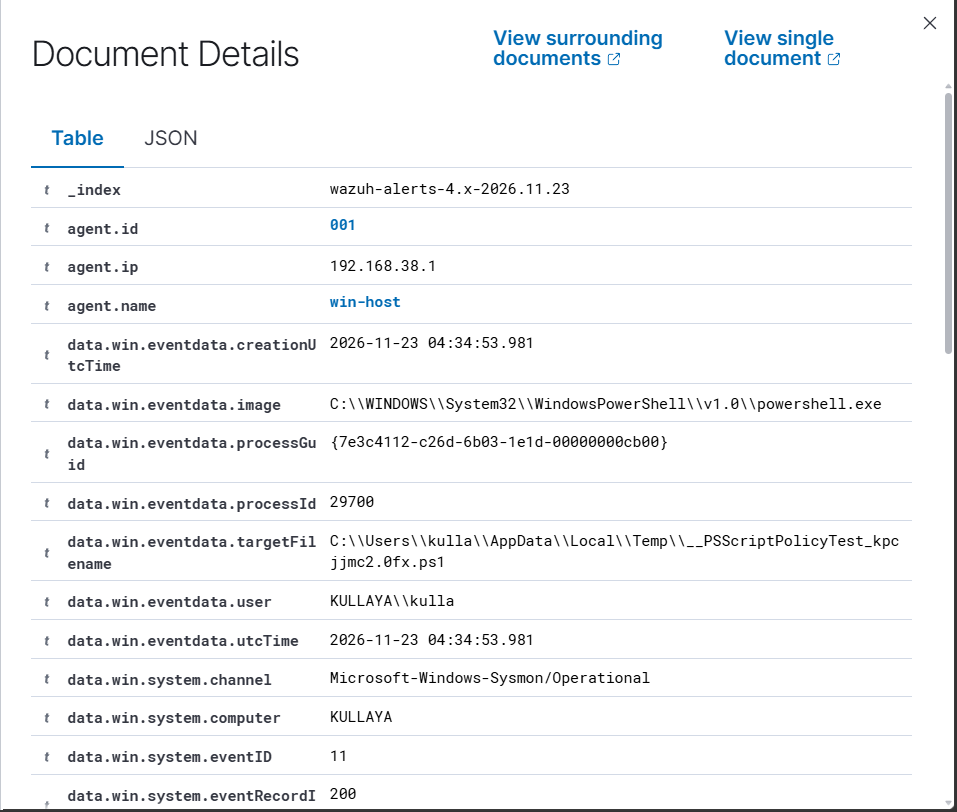

# 04 – จำลองการโจมตีและตรวจสอบ alert

> ทำเฉพาะกับเครื่องของตัวเองและเลือกเฉพาะการทดสอบที่ไม่ทำลายระบบ เพราะ endpoint ในแล็บนี้คือ Windows เครื่องจริง

## สรุปผล

| # | การทดสอบ | วิธี | Alert ที่ได้ (rule.id / level) | ผล |
|---|---|---|---|---|
| 1 | ล็อกอินผิด | `runas /user:fakeuser cmd` ใส่รหัสผิด 5 ครั้ง | 60122 Logon Failure / 5 | ✅ ตรวจพบ |
| 2a | Brute force ผ่าน SMB | `for /L %i in (1,1,12) do net use \\127.0.0.1\IPC$ /user:fakeuser WrongPass123 2>nul` | 92037 net.exe remote connection / 3 (×12, จาก Sysmon) และ 60122 / 5 (×1) | ⚠️ brute force rule ไม่ทำงาน |
| 2b | Brute force ด้วย runas | `runas /user:fakeuser cmd` ใส่รหัสผิดถี่ๆ ~10 ครั้ง | 60122 / 5 และ **60204 Multiple Windows Logon Failures / 10** | ✅ ตรวจพบ |
| 3 | สร้าง local user | `net user testuser P@ssw0rd123 /add` | 60109 User account enabled or created / 8, 60110 / 8, 60170 / 5, 60160 / 5 | ✅ ตรวจพบ |
| 4 | เพิ่ม user เข้า Administrators | `net localgroup administrators testuser /add` | **60154 Administrators Group Changed / 12** | ✅ ตรวจพบ |
| 4b | ลบ user | `net user testuser /delete` | 60111 User account disabled or deleted / 8 | ✅ ตรวจพบ |
| 5 | คำสั่งสำรวจระบบจาก cmd | `whoami /priv`, `systeminfo` | ไม่มี | ❌ **detection gap** → ปิดแล้วด้วย rule 100110 ใน [05](05-custom-rules.md) |
| 6 | SSH brute force ใส่ Wazuh server | `ssh hacker@192.168.38.130` ใส่รหัสผิดหลายครั้ง | sshd authentication failure / 5 และ brute force / 10 (50 alert) | ✅ ตรวจพบ |

---

## #1 Logon failure

**ช่องที่ใช้ triage**

| ช่อง | ความหมาย |
|---|---|
| `rule.description` / `rule.level` | alert คืออะไร และร้ายแรงแค่ไหน |
| `data.win.system.eventID` | 4625 = logon failure |
| `data.win.eventdata.targetUserName` | user ที่ถูกลองล็อกอิน (`fakeuser`) |
| `data.win.eventdata.logonType` | 2 = ที่ตัวเครื่อง, 3 = ผ่านเครือข่าย, 10 = RDP |
| `data.win.eventdata.subStatus` | `0xC0000064` = ไม่มี user นี้ (อาจเป็น user enumeration), `0xC000006A` = user มีจริงแต่รหัสผิด (password guessing) |
| `data.win.eventdata.logonProcessName` | `seclogo` = Secondary Logon (`runas`) |
| `data.win.eventdata.ipAddress` | `::1` = มาจากเครื่องตัวเอง |

## #2 Brute force

**2a – ผ่าน `net use` ไปที่ตัวเอง:** Sysmon จับ `net.exe` ได้ครบ 12 ครั้ง (rule 92037) แต่ Windows บันทึก event 4625 เพียงครั้งเดียว จึงไม่ถึงเกณฑ์ของ correlation rule

**2b – ด้วย `runas`:** ล็อกอินผิด 7 ครั้ง (60122) และครั้งที่ 8 ทำให้ **rule 60204 (level 10)** ทำงาน ซึ่งเป็น correlation rule ที่นับจำนวนครั้งในช่วงเวลาสั้นๆ

**บทเรียน:** detection ไม่ได้ทำงานตามที่คาดเสมอ และการที่ detection แบบหนึ่งพลาดแต่อีกแบบ (Sysmon) จับได้ คือเหตุผลของการวางระบบป้องกันหลายชั้น (defense in depth)

## #3–4 สร้าง user และยกสิทธิ์เป็น admin

| เวลา | การกระทำ | Alert | Level |
|---|---|---|---|
| 11:46:34 | `net user testuser /add` | 60109 User account enabled or created, 60110 User account changed, 60170/60160 group changed, 92039 net.exe (Sysmon) | 8 / 8 / 5 / 3 |
| 11:46:46 | `net localgroup administrators testuser /add` | **60154 Administrators Group Changed** | **12** |
| 11:48:59 | `net user testuser /delete` | 60111 User account disabled or deleted, 60154/60160/60170 | 8 / 12 / 5 |

**ข้อสังเกต**
- 60154 ได้ level สูงสุด เพราะการเพิ่ม user เข้ากลุ่ม admin คือ privilege escalation / persistence (MITRE T1098)
- pattern สร้าง user → ยกเป็น admin ภายใน 12 วินาที → ลบทิ้ง เป็นรูปแบบการลบร่องรอยที่ต้องสอบสวนทันทีหากพบในระบบจริง
- "Domain Users Group Changed" เกิดแม้เครื่องไม่อยู่ใน domain เพราะ Windows ใส่ user ใหม่เข้ากลุ่ม `None` อัตโนมัติ
- rule 92039 เรียก `net user /add` ว่า "account discovery" ซึ่งไม่ตรงนัก ต้องอ่าน log จริงประกอบ ไม่ใช่เชื่อชื่อ rule อย่างเดียว

## #5 Discovery commands – detection gap

รัน `whoami /priv` และ `systeminfo` จาก `cmd.exe` แล้ว**ไม่มี alert** ขณะที่ก่อนหน้านี้ rule 92033 *"Discovery activity spawned via powershell execution"* ทำงานเมื่อคำสั่งถูกเรียกจาก PowerShell

สรุป: rule เดิมจับเฉพาะ discovery ที่ parent เป็น PowerShell ผู้โจมตีเลี่ยงได้ด้วยการใช้ cmd → เขียน custom rule ปิดช่องนี้ใน [05](05-custom-rules.md)

## #6 SSH brute force ใส่ Wazuh server

ค้นหาใน Threat Hunting ด้วย `rule.groups: sshd` (agent 000 คือตัว manager ชื่อ `kullaya`)

- 50 alert: level 5 (ล็อกอินผิดแต่ละครั้ง) และ level 10 (brute force)
- MITRE: Password Guessing, SSH, Brute Force

---

## เคส triage: alert ที่ไม่ได้ตั้งใจสร้าง

### 92213 – Executable file dropped in folder commonly used by malware (level 15)

| คำถาม | หลักฐาน |
|---|---|
| ไฟล์อะไร | `C:\Users\kulla\AppData\Local\Temp\__PSScriptPolicyTest_kpcjjmc2.0fx.ps1` |
| ใครสร้าง | `C:\WINDOWS\System32\WindowsPowerShell\v1.0\powershell.exe` |
| user | `KULLAYA\kulla` |
| เวลา | 04:34:53 UTC (11:34:53 เวลาไทย) ตรงกับตอนเปิดหน้าต่าง PowerShell ใหม่ |
| ประเภท | Sysmon Event ID 11 (File created) |

PowerShell สร้างไฟล์ `__PSScriptPolicyTest_*.ps1` ทุกครั้งที่เปิด เพื่อทดสอบว่านโยบาย (AppLocker / execution policy) อนุญาตให้รัน script หรือไม่ แล้วลบทิ้ง alert เกิดซ้ำทุกครั้งที่เปิด PowerShell (พบอีกครั้งตอน 11:45:54)

**Verdict: False positive (benign)** → ทำ tuning ใน [05](05-custom-rules.md)

### 92058 – Application Compatibility Database launched (level 12)

พบตอน 11:56:00 ไม่ได้เกิดจากการทดสอบ – TODO: ตรวจ `image`, `commandLine`, `parentImage` แล้วสรุป verdict
