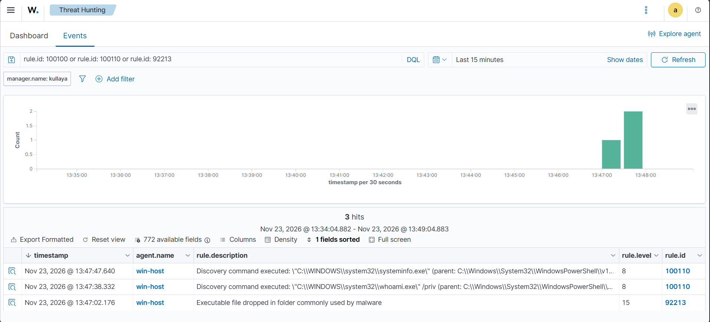
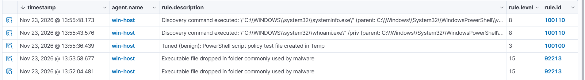
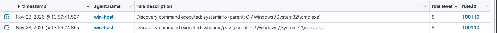

# 05 – Custom rules: detection tuning และปิด detection gap ✅

จากผลใน [04](04-attack-simulation.md) มีงาน 2 อย่าง:

| Rule | ประเภท | ปัญหา | แนวทาง |
|---|---|---|---|
| 100100 | Tuning | 92213 (level 15) ขึ้นทุกครั้งที่เปิด PowerShell ทำให้เกิด alert fatigue | ลดเหลือ level 3 **เฉพาะ**เมื่อชื่อไฟล์, โฟลเดอร์ และ process ที่สร้างตรงกับพฤติกรรมปกติของ PowerShell |
| 100110 | Detection | `whoami` / `systeminfo` จาก cmd ไม่มี alert | alert เมื่อโปรแกรมเหล่านี้ทำงาน ไม่ว่า parent จะเป็นอะไร (MITRE T1033, T1082) |

Rule ทั้งหมดอยู่ใน [`configs/local_rules.xml`](../configs/local_rules.xml)

## ทำไม rule 100100 ต้องเช็กหลายเงื่อนไข

ถ้าเช็กแค่ชื่อไฟล์ ผู้โจมตีสามารถตั้งชื่อมัลแวร์ให้ขึ้นต้นด้วย `__PSScriptPolicyTest_` เพื่อหลบได้ จึงต้องเช็กว่าไฟล์อยู่ใน `AppData\Local\Temp` และ process ที่สร้างคือ `powershell.exe` ของระบบด้วย ส่วนไฟล์อื่นที่ถูกวางใน Temp ยังได้ alert level 15 ตามเดิม

## ติดตั้ง rule (บน Wazuh server)

เขียนทับ `/var/ossec/etc/rules/local_rules.xml` ด้วยเนื้อหาจาก `configs/local_rules.xml` (เช่นใช้ `sudo nano` หรือ `sudo tee` + heredoc) แล้ว:

```bash
sudo systemctl restart wazuh-manager
sudo systemctl is-active wazuh-manager
```

ถ้า restart ไม่ผ่าน ดู error ได้จาก `sudo tail -n 30 /var/ossec/logs/ossec.log`

## รอบแรก: 100100 ไม่ทำงาน

หลังติดตั้งครั้งแรก rule 100110 ทำงาน แต่ 92213 level 15 ยังขึ้นอยู่ (100100 ไม่ match)



**สาเหตุ:** ค่าจาก Windows eventchannel ถูกเก็บใน Wazuh โดยมี **backslash เป็นคู่** (`C:\\Users\\kulla\\AppData\\Local\\Temp\\...`) ไม่ใช่ตัวเดียวแบบ path ปกติ

- pattern เดิม `\\AppData\\Local\\Temp` (backslash ตัวเดียวระหว่างโฟลเดอร์) จึงไม่ match
- rule 100110 match ได้โดยบังเอิญ เพราะเช็กแค่ `\systeminfo.exe$` ตอนท้าย ซึ่งตรงกับ backslash ตัวที่สองของคู่

**วิธีแก้:** เปลี่ยน `\\` เป็น `\\+` (backslash หนึ่งตัวขึ้นไป) ให้ match ได้ทั้งสองรูปแบบ

**บทเรียน:** เขียน rule จากข้อมูลจริงที่อยู่ใน alert (ดูจาก JSON / Document details) ไม่ใช่จากหน้าตาของ path ที่คิดว่าน่าจะเป็น

## ผลการทดสอบ

| Rule | วิธีทดสอบ | ผล |
|---|---|---|
| 100100 | เปิดหน้าต่าง PowerShell ใหม่ | ✅ ได้ 100100 level 3 แทน 92213 level 15 |
| 100110 | `whoami /priv`, `systeminfo` จาก PowerShell | ✅ level 8, parent = `powershell.exe` |
| 100110 | `whoami /priv`, `systeminfo` จาก **cmd** (gap เดิม) | ✅ level 8, parent = `cmd.exe` |



